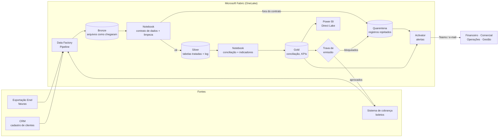

# Proposta: o processo rodando no Microsoft Fabric

**Ideia central:** reaproveitar **o mesmo código Python** do case (`src/`) dentro do Fabric, organizado em camadas, com a trava de emissão como etapa obrigatória antes de qualquer boleto sair e alertas automáticos para cada responsável.

## 1. Arquitetura

| Camada | Componente do Fabric | O que roda | Código do case |
|---|---|---|---|
| **Ingestão** | Data Factory (pipeline com *Copy*) | Copia os arquivos das 3 fontes para o OneLake | — |
| **Bronze** | Lakehouse (arquivos) | Guarda o arquivo **exatamente como chegou**, com data de recebimento. Permite reprocessar e auditar. | — |
| **Silver** | Notebook + tabelas Delta | Aplica o **contrato de dados** e a **limpeza**. O que não passa vai para a quarentena. Grava o log de inconsistências. | `validacao.validar_base`, `limpeza.executar_tratamento` |
| **Gold** | Notebook + tabelas Delta / SQL endpoint | Conciliação, classificação e indicadores. As consultas SQL viram **views** no endpoint SQL. | `conciliacao`, `indicadores`, `sql/consultas.sql` |
| **Trava** | Atividade do pipeline (Notebook) | Antes da emissão mensal, só envia ao sistema de cobrança os boletos **OK** | `validacao.validar_lote_cobranca` |
| **Consumo** | Power BI em modo *Direct Lake* | Dashboard lendo a camada Gold sem cópia de dados | modelo de `docs/GUIA_POWERBI.md` |
| **Alertas** | Activator | Dispara mensagens quando surgem regras violadas | — |

## 2. Quando roda

| Gatilho | O que dispara |
|---|---|
| **Chegada de arquivo** (evento no OneLake) | Ingestão, contrato de dados e limpeza. Problemas aparecem no mesmo dia. |
| **Diariamente** (agendado) | Conciliação completa e atualização do dashboard |
| **Antes do lote mensal de emissão** (ex.: dia 3, vencimento no dia 10) | Trava de emissão. **Nenhum boleto sai sem passar por ela.** |

## 3. Quem é avisado (Activator)

| Regra de alerta | Destino |
|---|---|
| Boleto bloqueado (valor, duplicidade, cliente cancelado) | Financeiro |
| Cliente sem desconto, UC sem cadastro | Comercial / CS |
| Energia compensada vazia ou maior que o consumo | Operações |
| Mais de 5% do arquivo em quarentena, ou pipeline com falha | Tecnologia |
| Inadimplência do mês acima do limite definido | Gestão |

Cada alerta leva o link da página do Power BI já filtrada para os registros do problema.

## 4. Registro rejeitado

1. Fica na tabela **quarentena** com o motivo, a linha de origem, o responsável e o prazo.
2. Não entra na Silver nem na emissão, mas **o resto do lote segue**.
3. Corrigido na origem, entra no próximo processamento automaticamente.
4. O histórico fica nas tabelas Delta (*time travel*), o que permite auditoria de "o que mudou e quando".

## 5. Como o código do case vai para o Fabric

- A pasta `src/` vira uma **biblioteca** (pacote `.whl`) instalada em um **Environment** do Fabric. Os notebooks importam as mesmas funções usadas aqui.
- `config.py` passa a ler os parâmetros (tolerância, data de corte, limites) de uma tabela de configuração, sem mexer no código.
- Os volumes do case (centenas de linhas/mês) rodam bem com **pandas** em notebook Python. Se a base crescer para milhões de linhas, as funções de limpeza migram para **PySpark** mantendo os mesmos nomes e regras.
- **Integração com Git** no workspace e **pipelines de implantação** (dev → teste → produção). Os **testes `pytest`** rodam no CI a cada mudança, e código que quebra uma regra não chega à produção.

## 6. Segurança e LGPD

CPF/CNPJ é **dado pessoal**. Na Gold e no Power BI, o documento aparece **mascarado** (ex.: `***.849.877-**`). O acesso ao dado completo fica restrito por **segurança em nível de linha/coluna** e por rótulo de sensibilidade.

## 7. Alternativa: API no backend (Go)

Se a Goener preferir embutir a trava no próprio sistema de cobrança, a mesma lógica vira um serviço:

| Endpoint | Entrada | Saída |
|---|---|---|
| `POST /v1/bases/validar` | arquivo (clientes, faturas ou cobranças) | lista de violações (aba, linha, coluna, regra, valor) |
| `POST /v1/lotes-cobranca/validar` | boletos propostos do mês | `aprovados`, `bloqueados` (com motivo), `faltantes` |
| `GET /v1/conciliacao?mes=2026-09` | mês | casos classificados e impacto |

O sistema de cobrança chama `/lotes-cobranca/validar` antes de emitir e só emite o que voltar em `aprovados`. As regras ficam em um único lugar, e os testes do case viram os casos de teste da API.

## 8. Implantação em fases

| Fase | Entrega | Valor |
|---|---|---|
| **1** | Pipeline + Bronze/Silver + contrato de dados + alertas de qualidade | Para de entrar dado sujo |
| **2** | Gold + Power BI | Gestão vê impacto e inadimplência todo dia |
| **3** | Trava de emissão integrada ao sistema de cobrança | Para de sair boleto errado |
